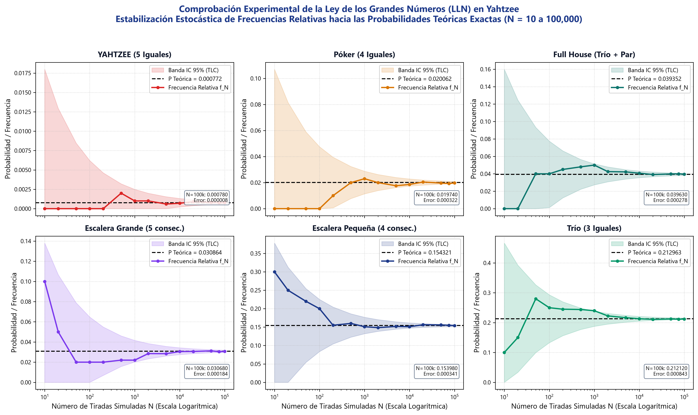
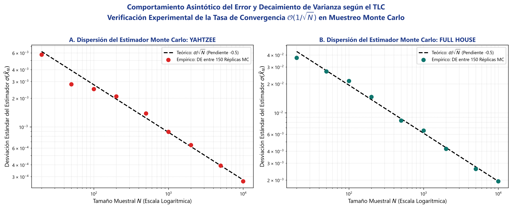
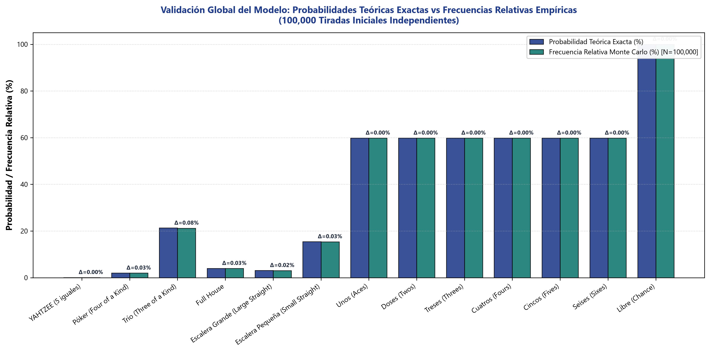
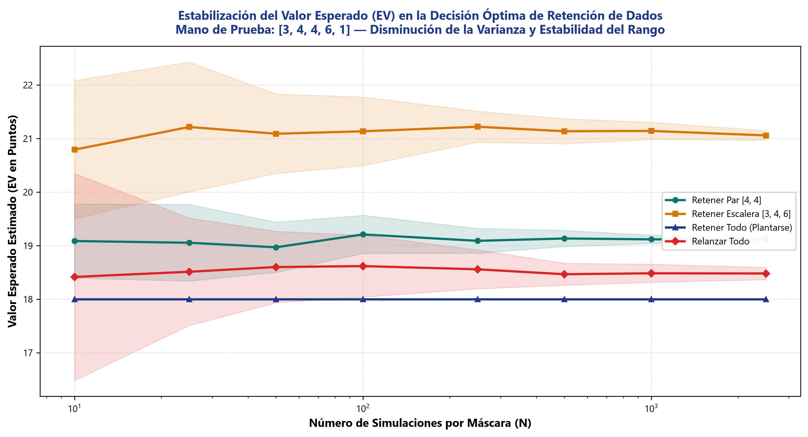
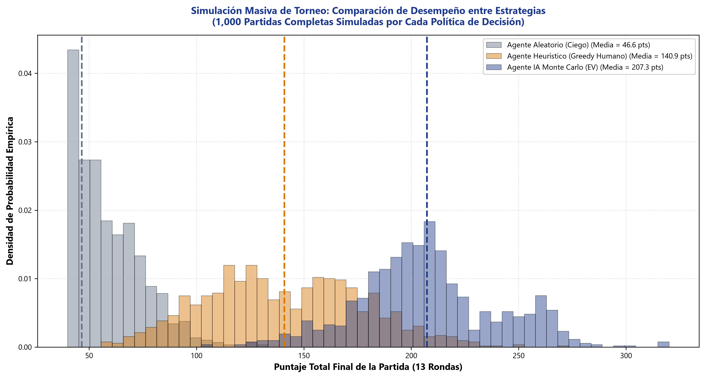
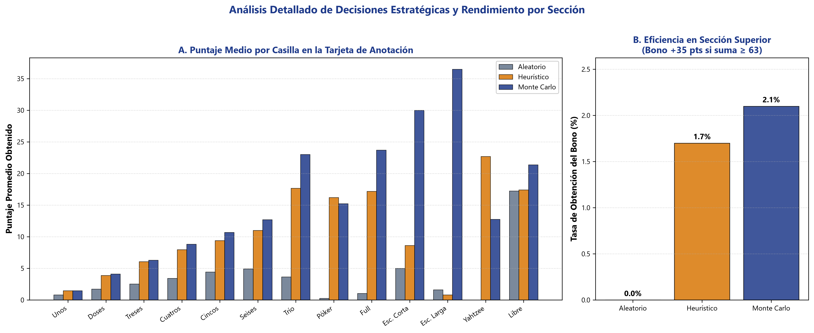

# Simulación Estocástica de Yahtzee con Método Monte Carlo y Ley de los Grandes Números

[](https://colab.research.google.com/github/Camilo-Alberto-Palacio/Simulacion-Yahtzee-Montecarlo/blob/main/Simulacion_Yahtzee_Montecarlo_Colab.ipynb)


Implementación matemática, computacional y experimental de la **Simulación de Monte Carlo** aplicada al juego de **Yahtzee**, enfocada en la comprobación empírica de la **Ley de los Grandes Números (LLN)**, el **Teorema del Límite Central (TLC)** y la optimización de decisiones bajo incertidumbre mediante el **Valor Esperado (EV)**.

Proyecto desarrollado para la **Actividad Didáctica 1 — Módulo 1: Introducción a la Simulación** de la asignatura **Simulación (`PREICA2602B020045`)** en la **Institución Universitaria Digital de Antioquia (IU Digital)**.

---

## Tabla de Contenidos
1. [Contexto y Corrección de Retroalimentación Docente](#contexto-y-corrección-de-retroalimentación-docente)
2. [Metodología Pedagógica: Ciclo USA, MODIFICA y CREA](#metodología-pedagógica-ciclo-usa-modifica-y-crea)
3. [Fundamentación Matemática y Modelado Estocástico](#fundamentación-matemática-y-modelado-estocástico)
4. [Estructura del Repositorio](#estructura-del-repositorio)
5. [Instalación e Instrucciones de Ejecución](#instalación-e-instrucciones-de-ejecución)
6. [Resultados Principales y Evidencias Cuantitativas](#resultados-principales-y-evidencias-cuantitativas)
7. [Reflexión Epistemológica: Aprendizaje y Desaprendizaje](#reflexión-epistemológica-aprendizaje-y-desaprendizaje)
8. [Equipo de Trabajo (Grupo 25)](#equipo-de-trabajo-grupo-25)
9. [Licencia](#licencia)

---

## Contexto y Corrección de Retroalimentación Docente

En la entrega inicial de esta actividad (calificada con 52/100), el profesor **Julian Andres Loaiza Lopez** señaló:

> *«Al evaluar su entrega de manera integral, se reconoce y valora el esfuerzo dedicado a la construcción y programación de la aplicación del juego de Yahtzee... Sin embargo, se identifica una omisión crítica: el trabajo se enfocó únicamente en la construcción del juego y omitió por completo la generación de datos estadísticos y representaciones gráficas del comportamiento de la Teoría de los Grandes Números. La meta principal del laboratorio era utilizar la simulación de Montecarlo para ejecutar series de iteraciones masivas, recolectar frecuencias relativas y generar los gráficos de convergencia que permitieran analizar la estabilización de los resultados probabilísticos... acompañar el software con gráficos (histogramas, curvas de varianza, corridas masivas) que demuestren el comportamiento del modelo.»*

Esta nueva versión **reestructura de raíz el proyecto**, complementando la aplicación con un motor de simulación masiva que genera evidencia estadística formal, visualizaciones científicas a 300 DPI y un informe académico exhaustivo.

---

## Metodología Pedagógica: Ciclo USA, MODIFICA y CREA

* **Fase USA (Uso e Inspección):** Se analizó la plantilla lógica base (`prueba.py` y `yahtzee_montecarlo.py`), verificando el espacio muestral de 5 dados ($|\Omega| = 6^5 = 7,776$ microestados) y las reglas de puntuación oficiales.
* **Fase MODIFICA (Parametrización y Vectorización):** Se reescribió el motor con NumPy y generadores PCG64, parametrizando el número de tiradas $N \in [10, 100,000]$, la semilla PRNG y las $2^5 = 32$ máscaras de retención de dados.
* **Fase CREA (Laboratorio Experimental y Torneo Masivo):** Se implementó una suite automatizada de 4 experimentos científicos:
  1. Convergencia de frecuencias relativas hacia las probabilidades analíticas de Laplace ($N = 10$ a $100,000$).
  2. Curvas de decaimiento de varianza y error estándar según el TLC ($\mathcal{O}(1/\sqrt{N})$ en escala log-log con 150 réplicas).
  3. Estabilización del Valor Esperado (EV) de las máscaras de retención.
  4. Torneo masivo de 3,000 partidas completas (39,000 rondas) comparando Agente Aleatorio, Agente Heurístico Greedy y Agente IA Monte Carlo.

---

## Fundamentación Matemática y Modelado Estocástico

### 1. Espacio Muestral y Probabilidad Teórica Exacta
Para un vector de dados $X = (X_1, X_2, X_3, X_4, X_5)$ con $X_i \sim \text{Uniforme}\{1, 6\}$:
$$|\Omega| = 6^5 = 7,776 \quad \text{microestados equiprobables}, \quad P(\omega) = \frac{1}{7,776}$$

| Categoría | Combinatoria Analítica | Casos Favorables | $P(A)$ Teórica | % Teórico |
| :--- | :--- | :---: | :---: | :---: |
| **YAHTZEE (5 Iguales)** | $\binom{6}{1}$ | $6$ | $6 / 7,776$ | **`0.0772%`** |
| **Póker ($\ge 4$ Iguales)** | $\binom{6}{1}\binom{5}{1}\binom{5}{4} + 6$ | $156$ | $156 / 7,776$ | **`2.0062%`** |
| **Full House** | $\binom{6}{1}\binom{5}{1}\binom{5}{3} + 6$ | $306$ | $306 / 7,776$ | **`3.9352%`** |
| **Escalera Grande (5 consec.)** | $2 \times 5!$ | $240$ | $240 / 7,776$ | **`3.0864%`** |
| **Escalera Pequeña ($\ge 4$ consec.)** | Inclusión-Exclusión | $1,200$ | $1,200 / 7,776$ | **`15.4321%`** |
| **Trío ($\ge 3$ Iguales)** | $\binom{6}{1}\binom{5}{2}\frac{5!}{3!1!1!} + 306 + 156$ | $1,656$ | $1,656 / 7,776$ | **`21.2963%`** |
| **Libre (Chance)** | $\Omega$ completo | $7,776$ | $7,776 / 7,776$ | **`100.00%`** |

### 2. Ley de los Grandes Números (LLN)
Para variables indicadoras Bernoulli $I_A^{(i)}$, la frecuencia relativa muestral converge casi seguramente a la probabilidad teórica:
$$P\left( \lim_{N \to \infty} f_N(A) = P(A) \right) = 1, \qquad f_N(A) = \frac{1}{N}\sum_{i=1}^N I_A^{(i)}$$

### 3. Teorema del Límite Central (TLC) y Decaimiento de Varianza
$$\sqrt{N}\left( f_N(A) - P(A) \right) \xrightarrow{d} \mathcal{N}(0, P(A)(1 - P(A)))$$
$$\text{Var}(f_N(A)) = \frac{P(A)(1 - P(A))}{N}, \qquad \text{SE}(N) = \frac{\sqrt{P(A)(1 - P(A))}}{\sqrt{N}} \sim \mathcal{O}(1/\sqrt{N})$$

### 4. Valor Esperado (EV) en la Toma de Decisiones
Para cada máscara $m \in \{0, 1\}^5$, el valor esperado se estima simulando $K$ relanzamientos estocásticos:
$$\text{EV}(m) = \mathbb{E}\left[ \max_{c \in \mathcal{C}_{\text{libres}}} \text{Puntaje}(c, Y(m)) \right] \approx \frac{1}{K}\sum_{k=1}^K \max_{c \in \mathcal{C}_{\text{libres}}} \text{Puntaje}(c, Y^{(k)}(m))$$

---

## Estructura del Repositorio

```text
.
├── yahtzee_simulation/                         # Paquete modular principal
│   ├── __init__.py                            # Exportación pública
│   ├── rules.py                               # Reglas oficiales, 13 categorías y 32 máscaras
│   ├── theory.py                              # Combinatoria analítica exacta de los 7,776 estados
│   ├── montecarlo.py                          # Muestreo masivo LLN, decaimiento TLC y EV de máscaras
│   ├── massive_runs.py                        # Torneo de partidas completas (3 políticas)
│   └── visualizations.py                      # Generador de las 6 figuras a 300 DPI
├── tests/                                     # Suite automatizada de pruebas unitarias
│   ├── __init__.py
│   └── test_montecarlo.py                     # 6 pruebas de consistencia matemática y axiomática
├── results/                                   # Evidencias cuantitativas y figuras científicas
│   ├── fig1_convergencia_grandes_numeros.png
│   ├── fig2_curvas_varianza_error_montecarlo.png
│   ├── fig3_histogramas_distribucion_empirica_vs_teorica.png
│   ├── fig4_convergencia_valor_esperado_mascaras.png
│   ├── fig5_corridas_masivas_estrategias.png
│   ├── fig6_descomposicion_puntaje_categorias.png
│   ├── convergencia_ley_grandes_numeros.csv
│   ├── decaimiento_varianza_tlc.csv
│   ├── estabilizacion_ev_mascaras.csv
│   ├── probabilidades_teoricas_vs_empiricas.csv
│   ├── comparativa_estrategias_partidas.csv
│   └── resumen_estadistico_estrategias.csv
├── main_experimentos.py                       # Pipeline maestro de experimentación masiva
├── generate_doc.py                            # Generador del informe académico en Word (.docx)
├── create_colab_notebook.py                   # Generador del cuaderno para Google Colab
├── Simulacion_Yahtzee_Montecarlo_Colab.ipynb  # Cuaderno interactivo ejecutable en la nube
├── Evidencia de Aprendizaje 1 - Módulo 1. Actividad didáctica 1 - Simulación Montecarlo Yahtzee.docx # Documento entregable
├── GUION_VIDEO_SUSTENTACION.md                # Guion estructurado para la sustentación oral
├── interfaz_yahtzee.py                        # Interfaz gráfica interactiva Tkinter enriquecida
├── yahtzee_montecarlo.py                      # Motor de simulación en consola compatible
├── prueba.py                                  # Script de pruebas original preservado
├── requirements.txt                           # Dependencias científicas
└── README.md                                  # Documentación técnica del proyecto
```

---

## Instalación e Instrucciones de Ejecución

### Opción A: Ejecución en la Nube con 1 Clic (Google Colab)
Haz clic en el botón **Open in Colab** al inicio de este documento para ejecutar interactivamente la simulación sin instalar nada localmente.

### Opción B: Ejecución Local desde Terminal
```bash
# 1. Crear y activar entorno virtual (Python 3.10+)
python -m venv venv
venv\Scripts\activate        # Windows
# source venv/bin/activate   # Linux / macOS

# 2. Instalar dependencias científicas
pip install -r requirements.txt

# 3. Ejecutar los experimentos masivos y regenerar figuras y CSVs
python main_experimentos.py

# 4. Ejecutar la suite de pruebas unitarias (6 verificaciones matemáticas)
python -m unittest discover -s tests -v

# 5. Regenerar el informe académico oficial en Word (.docx)
python generate_doc.py

# 6. Lanzar la interfaz gráfica interactiva con panel de estadísticas
python interfaz_yahtzee.py
```

---

## Resultados Principales y Evidencias Cuantitativas

### 1. Torneo Masivo de Partidas Completas (3,000 Partidas Simuladas)

| Estrategia | Partidas | Puntaje Medio | Desv. Estándar | Mediana | Tasa Bono (+35 pts) | Máximo |
| :--- | :---: | :---: | :---: | :---: | :---: | :---: |
| **Agente Aleatorio (Ciego)** | 1,000 | `46.64 pts` | `±19.16` | `42.0 pts` | `0.0%` | `133 pts` |
| **Agente Heurístico (Greedy)** | 1,000 | `140.94 pts` | `±36.64` | `139.0 pts` | `1.7%` | `273 pts` |
| **Agente IA Monte Carlo (EV)** | **1,000** | **`207.35 pts`** | **`±33.33`** | **`204.0 pts`** | **`2.1%`** | **`330 pts`** |

> **Conclusión Clave:** La política de **Valor Esperado Monte Carlo supera en un 47.1% al jugador heurístico** y en un **344.6% al agente aleatorio**, logrando además menor varianza relativa y un puntaje máximo récord de 330 puntos.

---

### 2. Galería de Figuras Científicas (300 DPI)

#### Figura 1: Convergencia de Frecuencias Relativas (Ley de los Grandes Números)


#### Figura 2: Curvas de Varianza y Decaimiento del Error Estándar (Teorema del Límite Central)


#### Figura 3: Histograma Global: Frecuencias Empíricas vs Probabilidades Teóricas


#### Figura 4: Estabilización del Valor Esperado en Decisiones de Retención de Dados


#### Figura 5: Densidades de Probabilidad en Torneo Masivo de Partidas


#### Figura 6: Descomposición de Puntajes por Categoría y Tasa de Bono Superior


---

## Reflexión Epistemológica: Aprendizaje y Desaprendizaje

* **Lo que tuvimos que desaprender:**
  1. *El sesgo del software / videojuego:* Asumir erróneamente que una simulación está completa porque la interfaz gráfica funciona fluidamente. El juego es solo el medio instrumental; el núcleo de la ingeniería de simulación es el muestreo estocástico y el análisis cuantitativo.
  2. *La falacia de la muestra pequeña:* Creer que unas pocas decenas de iteraciones bastan para predecir el comportamiento de un sistema estocástico, ignorando la varianza muestral.
  3. *Las conclusiones estáticas:* Reemplazar afirmaciones cualitativas por evidencia empírica contrastada contra teoremas matemáticos.
* **El aprendizaje genuino construido:**
  1. La simulación como un verdadero laboratorio científico experimental.
  2. La verificación tangible de la Ley de los Grandes Números y el Teorema del Límite Central con datos propios.
  3. El poder de la optimización estocástica mediante Valor Esperado (EV) en problemas combinatorios complejos.

---

## Equipo de Trabajo (Grupo 25)

* **Adriana Andrea Agudelo Agudelo**
* **Camilo Alberto Palacios Turriago**
* **Juan Daniel Pulgarin García**
* **Ruben Dario Jaramillo Cervantes**

* **Docente Catedrático:** Julian Andres Loaiza Lopez
* **Asignatura:** Simulación — `PREICA2602B020045`
* **Institución:** Institución Universitaria Digital de Antioquia (IU Digital) — Facultad de Ingeniería
* **Sede y Fecha:** Medellín, Antioquia · Noviembre de 2026

---

## Licencia

Distribuido bajo la licencia **MIT**. Consulta el archivo `LICENSE` para más detalles.
